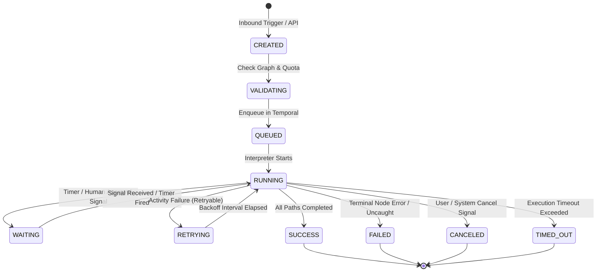

# OVRA Execution Engine Specification

**Document ID:** OVRA-ENG-001  
**Version:** 1.0.0  
**Status:** Baseline locked  
**Date:** 2026-11-03  

## 1. Overview
The execution engine is the distributed core of OVRA. It translates declarative workflow graphs into durable distributed executions. The engine is built on top of Temporal, separating graph interpretation and flow control from activity execution.

## 2. Temporal Workflow vs Activity Boundary

### Deterministic Workflow Code (Orchestrator)
- Evaluates the compiled DAG and determines node readiness based on upstream dependencies.
- Handles conditional branching, switch routing, and bounded loops (`maxIterations`).
- Evaluates OEL (OVRA Expression Language) expressions on cached node output payloads (pure deterministic computation).
- Schedules Activity tasks for ready nodes via Temporal task queues.
- Awaits Activity completion, failure, or timeout.
- Receives external signals for human approval gates, webhooks, or pause/resume/cancellation.
- Manages durable sleep/timers via Temporal native timers.

**Strict Prohibitions in Workflow Code:**
- No I/O, file access, or network calls (HTTP, databases, RPCs).
- No non-deterministic functions: `Math.random()`, `Date.now()`, `crypto.randomUUID()` (must use Temporal deterministic workflow APIs if needed).
- No shared mutable global state across workflow executions.

### Activity Code (Worker Fleet)
- Fetches the immutable published workflow snapshot from the registry.
- Requests short-lived credential leases from the Credential Broker.
- Executes external HTTP requests, database queries, SaaS connector APIs, and AI model calls.
- Performs file uploads/downloads to S3-compatible object storage.
- Sends live execution projection updates to PostgreSQL and outbox/realtime pipelines.
- Executes sandboxed code in isolated runtimes (when enabled).

## 3. Execution Lifecycle & State Machine



## 4. Node Execution Contract

Every node activity executes with an isolated, typed data envelope:

```typescript
export interface FlowData {
  json: Record<string, unknown>;
  binary?: Array<{
    storageKey: string;
    fileName: string;
    mimeType: string;
    size: number;
  }>;
  metadata: {
    executionId: string;
    workflowId: string;
    workflowVersion: number;
    nodeId: string;
    attempt: number;
    timestamp: string;
  };
}
```

## 5. Idempotency & The OUTCOME_UNKNOWN State

### The Reality of Distributed Side Effects
When an Activity executes a network call to an external service (e.g. Razorpay, WhatsApp Business, Stripe) and encounters a network timeout, connection reset (`ECONNRESET`), or HTTP 504 Gateway Timeout, the outcome on the provider side is ambiguous. The external system may have completed the operation, failed to receive it, or be mid-processing.

### Engine Rules:
1. **Idempotency Keys:** Every side-effecting activity must generate a deterministic idempotency key derived from:
   `sha256(executionId + ":" + nodeId + ":" + attemptOrStep)`
   and transmit it in supported API headers (e.g., `Idempotency-Key` or `X-Request-Id`).
2. **`OUTCOME_UNKNOWN` Handling:**
   - If a provider supports idempotency, the Activity safely retries using the identical idempotency key.
   - If a provider DOES NOT support idempotency, the Activity MUST NOT automatically retry without reconciliation. It marks the node execution as `OUTCOME_UNKNOWN`.
   - The workflow may either pause for human intervention, trigger an automated status verification activity (polling the provider GET endpoint if available), or route to a dedicated compensation branch.
