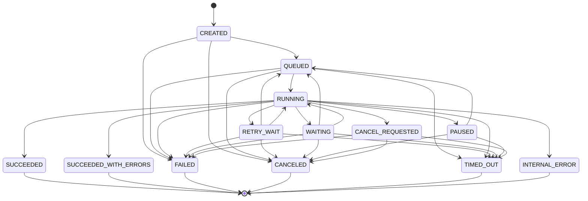

# Authoritative Execution State Machine Specification

**Milestone:** 2.7  
**Architecture Layer:** OVRA Node Runtime & Workflow Orchestration  
**Status:** Canonical Reference

---

## 1. Domain States

### Workflow Execution States (`WorkflowExecutionStatus`)
| State | Type | Description |
|---|---|---|
| `CREATED` | Transient | Execution record exists; validation/snapshot pending |
| `QUEUED` | Pending | Enqueued for scheduling / waiting for worker lease |
| `RUNNING` | Active | At least one task is actively executing with a valid lease |
| `RETRY_WAIT` | Pending | Transient failure awaiting scheduled exponential backoff |
| `WAITING` | Suspended | Bounded external wait (human approval, webhook trigger, delay) |
| `PAUSED` | Suspended | Operator requested pause; safe checkpoint reached |
| `CANCEL_REQUESTED` | Transient | Cancellation initiated; cleanup in progress |
| `SUCCEEDED` | Terminal | All reachable required paths completed successfully |
| `SUCCEEDED_WITH_ERRORS` | Terminal | Non-fatal errors handled via error ports; all paths terminal |
| `FAILED` | Terminal | Unhandled fatal error or retry budget exhausted |
| `CANCELED` | Terminal | Cancellation completed; all active tasks aborted |
| `TIMED_OUT` | Terminal | Workflow-level deadline exceeded |
| `INTERNAL_ERROR` | Terminal | Invariant violation or unrecoverable infrastructure failure |

---

## 2. Allowed State Transitions

### Invariants:
1. **Terminal State Immutability:** Once an execution reaches `SUCCEEDED`, `SUCCEEDED_WITH_ERRORS`, `FAILED`, `CANCELED`, `TIMED_OUT`, or `INTERNAL_ERROR`, no subsequent transition is permitted.
2. **Re-Execution Lineage:** Retrying an execution spawns a new execution attempt with parent lineage reference, never mutating historical terminal records.
3. **No Phantom Running:** An execution may only be `RUNNING` if an active worker or async task holds a valid, non-expired lease.
