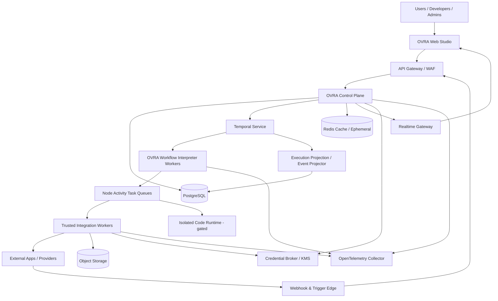

# OVRA System Architecture Specification

**Document ID:** OVRA-ARCH-001  
**Version:** 1.0.0  
**Status:** Baseline locked; changes require ADR approval  
**Date:** 2026-11-03  
**Owner:** OVRA Product / Engineering

## 1. Purpose

This document defines the target architecture for OVRA, a multi-tenant workflow automation platform with a visual editor, API and webhook automation, a durable distributed execution engine, integration SDK, AI/agent capabilities, testing tools and both hosted and self-hosted deployment models.

It is the architectural contract for implementation. It is not evidence that the platform has been built, benchmarked, security-tested, or certified.

## 2. Product outcomes

OVRA must let:

- Non-technical users create and operate automations through a guided visual builder.
- Developers compose APIs, events, data transformations, branches, bounded loops, subworkflows and custom integrations.
- Organizations isolate users, credentials, workflows, executions, files and usage by tenant and workspace.
- Operators inspect each execution, recover from failure and diagnose system health.
- AI agents propose and execute approved actions under explicit tool permissions, budgets and human approval gates.
- Enterprises deploy OVRA in OVRA-managed cloud infrastructure or in a customer-controlled environment.

## 3. Architectural principles

1. **Durability before throughput.** A workflow must survive process and worker restarts before aggressive scale-out is considered.
2. **Control plane / execution plane separation.** User management, workflow management and orchestration coordination are separated from task execution.
3. **Immutable published inputs.** An execution uses the exact workflow, node and engine compatibility snapshot captured at start.
4. **At-least-once execution with idempotency.** External side effects must be explicitly protected; exactly-once is not promised.
5. **Tenant isolation by default.** Every resource lookup is authorized against the authenticated principal and owning tenant/workspace.
6. **Untrusted workloads are isolated.** No arbitrary user code runs in trusted services.
7. **Observable by design.** Logs, traces, metrics and user-facing execution events are designed into contracts.
8. **Modular first, distributed where justified.** Avoid premature microservices; keep clear package and process boundaries.
9. **Portable workflows.** Workflow definitions are versioned and exportable without secrets.
10. **Explicit AI authority.** Models can propose actions; policy services authorize actions.

## 4. Scope and non-goals

### In scope

- Multi-tenant organizations/workspaces, users, roles and API credentials.
- Workflow drafts, validation, immutable published versions and activation.
- Webhook, schedule and manual triggers.
- DAG planning and execution with sequential/parallel paths, conditions, bounded loops, waits, approvals and child workflows.
- Retry, cancellation, timeout, checkpoint/recovery, execution history and replayable product events.
- Connector SDK and credential broker.
- Secure HTTP and integration execution.
- WebSocket status updates and editor collaboration foundations.
- AI gateway, AI nodes, agent tool calls, RAG/MCP extension points and evaluation.
- TestLab, observability, usage metering, cloud and self-hosting foundations.

### Explicitly not in the first implementation slice

- Public marketplace with arbitrary third-party packages.
- Arbitrary user code execution before isolated runtime approval.
- Multi-region active-active control plane.
- Unbounded graph cycles or unbounded loops.
- A promise of exactly-once external effects.
- A claim of regulatory certification or legal compliance.
- A promise of unlimited scale or unmeasured SLOs.

## 5. System context

## 6. Logical architecture

### 6.1 Client layer

- **Web Studio:** Next.js, React, TypeScript, React Flow. Owns visual editing, forms, previews, onboarding and execution observation.
- **Developer interface:** REST API, OpenAPI, SDK, CLI and workflow-as-code tools. These can be delivered incrementally.
- **Client security:** never place provider credentials or decrypted secrets in browser storage. Browser state contains only authorized metadata and masked credential status.

### 6.2 Edge layer

- TLS termination, WAF/bot controls where required, request-size limits and routing.
- API authentication and rate limiting at edge and application layers.
- Webhook ingress separated from the normal user API surface where practical.
- All user-supplied outbound URLs are handled by a server-side egress enforcement service, not by the edge gateway.

### 6.3 Control plane

Start as a **modular NestJS application using Fastify**, with strict module boundaries. Extract a module into a separate deployable service only when scaling, security isolation, operational ownership or release cadence justifies it.

Modules:

- Identity and sessions.
- Organizations, workspaces, memberships and authorization.
- Workflow registry, drafts, validation and immutable publishing.
- Trigger registration and lifecycle.
- Execution command API and projections.
- Credential metadata and broker authorization.
- Integration/node registry.
- Realtime subscription authorization.
- Audit, usage and billing foundations.
- AI gateway policy and model configuration.

The control plane must not execute node code or make long-running provider calls on request threads.

### 6.4 Execution plane

- **Temporal Service:** durable workflow state, event history, timers, signals, task scheduling and recovery.
- **OVRA Workflow Interpreter:** deterministic Temporal Workflow code. Loads the immutable run snapshot through an Activity, validates the compiled graph and schedules node activities according to OVRA semantics.
- **Node Activity Workers:** trusted worker pools for first-party connectors, split by runtime/capability and risk class.
- **Code Runtime:** a separate, disabled-by-default isolated service for user-authored code. It must not share API credentials, host mounts, privileged service accounts or unrestricted network access.
- **Trigger services:** validate inbound triggers and start or signal Temporal workflows through authenticated service identities.

### 6.5 Data plane

| Technology | Responsibility | Must not be used for |
|---|---|---|
| PostgreSQL | Domain records, workflow definitions, immutable versions, credential metadata, audit records, execution projections, outbox and durable product event projection | Acting as an ad hoc distributed scheduler |
| Temporal persistence | Authoritative orchestration history and workflow progress | General-purpose product database |
| Redis | Cache, rate-limit counters, short-lived presence/coordination and socket adapter support | Sole storage for executions, triggers or workflow definitions |
| S3-compatible object storage | Binary payloads, files, large artifacts and exports | Publicly accessible unscoped secret storage |
| NATS JetStream (later/conditional) | Durable fan-out of domain/integration events when operationally justified | Replacing Temporal, node task scheduling or workflow state |

## 7. Locked technology baseline

| Concern | Baseline | Notes |
|---|---|---|
| Frontend | Next.js + React + TypeScript | Strict TypeScript; accessible component system |
| Graph canvas | React Flow (@xyflow/react) | Graph presentation only; backend validates canonical graph |
| UI styling | Tailwind CSS + shadcn/ui | Avoid bespoke component divergence |
| Server state | TanStack Query | Server cache, invalidation and pagination |
| Editor state | Zustand | Local visual state only; must not become server source of truth |
| Backend | NestJS + Fastify adapter | Modular monolith first |
| API contract | REST + OpenAPI, `/api/v1` | Versioned, schema-validated and idempotency-aware |
| Realtime | WebSocket (Socket.IO adapter) | Durable replay over REST/event cursor |
| Primary database | PostgreSQL 16+ | Migrations, constraints, RLS defense-in-depth |
| Data access | Drizzle ORM (preferred for native transaction-local RLS GUC) or Prisma | Do not weaken RLS or transaction control |
| Orchestration | Temporal TypeScript SDK | Required for durable orchestration |
| Cache | Redis 7+ | Ephemeral only |
| Object storage | S3-compatible API | Private buckets, scoped access and lifecycle policies |
| Event bus | NATS JetStream (conditional) | Use only for cross-service event fan-out |
| Secrets | Cloud KMS or Vault Transit + envelope encryption | Provider abstraction; no static master key in app config |
| Containerization | Docker / OCI images | Non-root, minimal images, SBOM and image scanning |
| Orchestration | Kubernetes + Helm | Network policies and restricted pod security |
| Infrastructure as code | Terraform | Reproducible cloud resources |
| Observability | OpenTelemetry + Prometheus/Grafana + Loki/Tempo | Redaction and sampling policies required |
| Tests | Vitest, Playwright, Testcontainers, k6 | Continuous regression test suites |

## 8. Execution architecture decisions

- Temporal is the durable orchestrator.
- OVRA owns the workflow graph model and interpreter.
- Workflow definitions are immutable after publish.
- Each run pins workflow version, engine version, node package versions, trigger payload reference and relevant policy snapshot.
- Workflow code is deterministic. All I/O and side effects occur in Activities/services.
- Tasks are retriable and potentially delivered more than once.
- Side-effecting nodes require a documented idempotency strategy.
- Ambiguous external outcomes are represented explicitly; do not blindly retry a non-idempotent operation.
- Loops are explicit and bounded; graph cycles are rejected.
- Long waits and human approvals use Temporal timers/signals, not sleeping workers.
- Execution state in the product database is a projection; Temporal owns orchestration state.

## 9. References

- Temporal event history and replay: <https://docs.temporal.io/encyclopedia/event-history>
- Temporal TypeScript SDK: <https://docs.temporal.io/develop/typescript>
- OWASP API Security Top 10: <https://owasp.org/API-Security/editions/2023/en/0x11-t10/>
- OAuth 2.0 Security BCP, RFC 9700: <https://www.rfc-editor.org/rfc/rfc9700.html>
- gVisor security model: <https://gvisor.dev/docs/architecture_guide/security/>
- Kubernetes NetworkPolicies: <https://kubernetes.io/docs/concepts/services-networking/network-policies/>
- OpenTelemetry signals: <https://opentelemetry.io/docs/concepts/signals/>
- HashiCorp Vault envelope encryption: <https://developer.hashicorp.com/vault/docs/secrets/transit/envelope-encryption>
