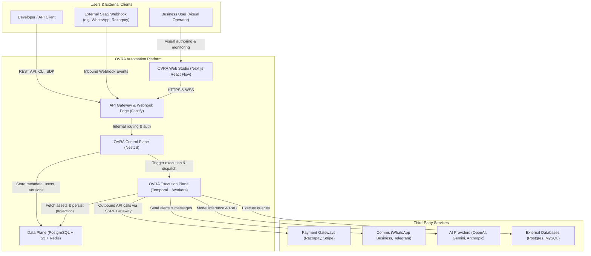
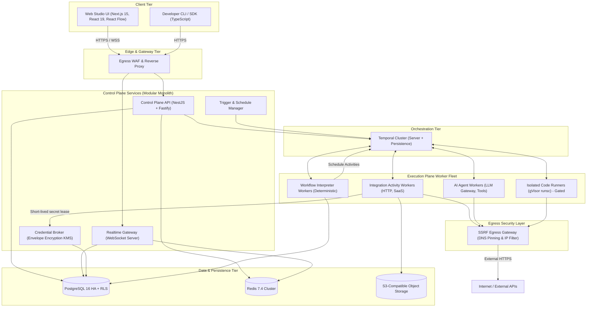
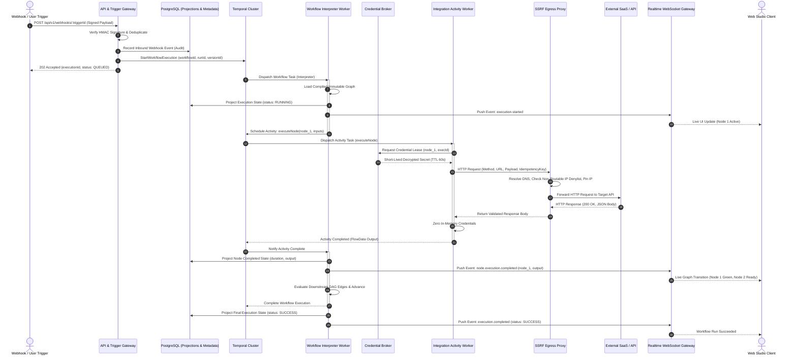
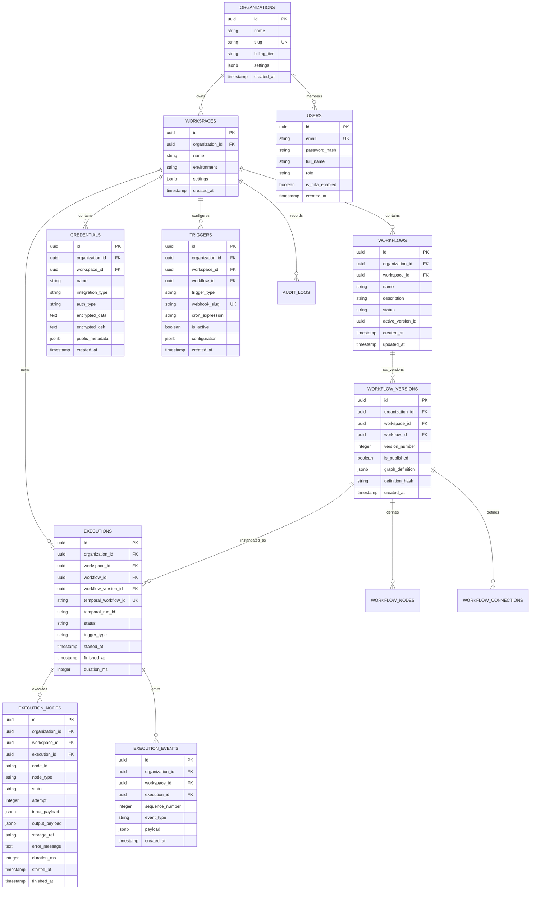

# OVRA System Architecture Diagrams

**Document ID:** OVRA-DIA-001  
**Version:** 1.0.0  
**Date:** 2026-11-03  
**Status:** Approved Specification Baseline  

---

## 1. System Context Diagram (C4 Level 1)

---

## 2. Container Diagram (C4 Level 2)

---

## 3. Workflow Execution Sequence Diagram

---

## 4. Logical Entity-Relationship (ER) Diagram

